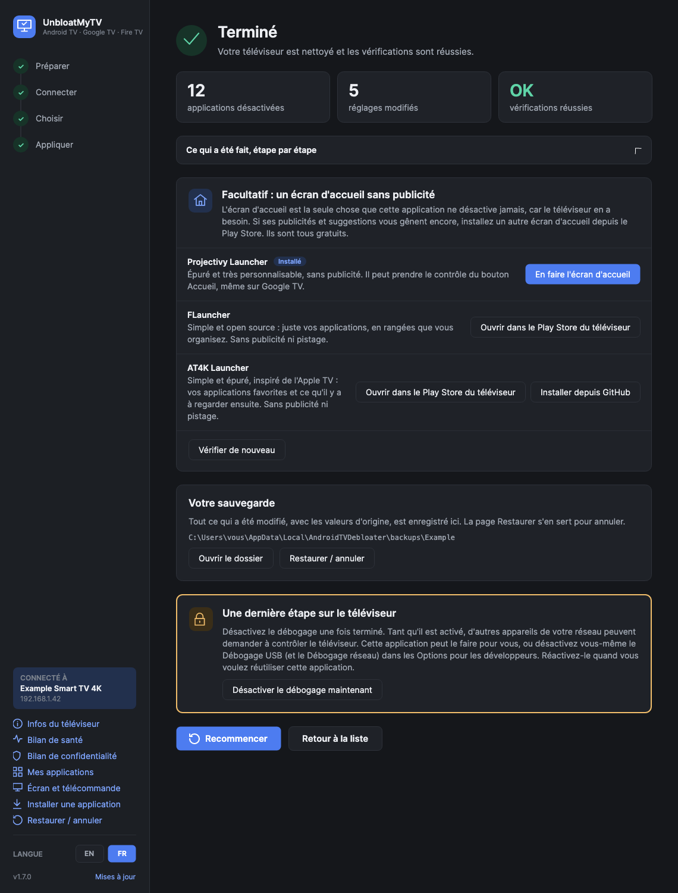

<h1 align="center">UnbloatMyTV</h1>

  Désactivez les publicités, le pistage et les applications préinstallées de n'importe quel Android TV, Google TV ou Fire TV. 
  Pour Windows, macOS et Linux. Des choix expliqués simplement, une sauvegarde de tout, une annulation en un clic.

  
  
  
  
   Anciennement « Android TV Debloater ».
   <a href="README.md">English version</a>

## Télécharger

Prenez le fichier de votre ordinateur dans la **[dernière version](../../releases/latest)**. Rien
d'autre à installer : la première fois, l'application télécharge les outils ADB officiels de Google
(environ 7 Mo, depuis `dl.google.com`) dans son propre dossier.

| | Fichier | Premier lancement |
|---|---|---|
| **Windows** 10/11 | `UnbloatMyTV.exe` | SmartScreen peut indiquer un éditeur inconnu (l'exe n'est pas encore signé) : **Informations complémentaires → Exécuter quand même**. |
| **macOS** 14+ | `UnbloatMyTV-mac.zip` | Application Mac native pour Apple silicon et Intel, signée et notariée par Apple. Décompressez, placez-la dans Applications, ouvrez-la et autorisez-la à trouver des appareils sur le réseau local. |
| **Linux** x64 | `UnbloatMyTV-x86_64.AppImage` | La plupart des distributions (Ubuntu 22.04 et plus récent, Fedora, Debian, Arch…). Rendez-le exécutable (`chmod +x`, ou Propriétés → Autoriser l'exécution) et ouvrez-le. |

Chaque version se met à jour toute seule : elle affiche les nouveautés et installe la mise à jour en
quelques secondes.

## Ce que fait l'application

**Nettoyer**
- **Trouve votre téléviseur sur le réseau** et s'y connecte en Wi-Fi ou Ethernet. Sans câble, sans root.
- **Liste uniquement ce qui se trouve sur votre téléviseur**, expliqué simplement : pistage,
  publicités et mode démo, composants système inutilisés, fonctions Google, applications
  préinstallées, réglages de vitesse et de confidentialité.
- **Coche pour vous les choix sans risque.** Ce que vous pourriez utiliser (recherche vocale,
  diffusion, streaming) reste décoché, avec un avertissement sur ce qui ne fonctionnera plus.
- **Accélère le téléviseur** : animations plus rapides, moins d'applications en mémoire, gel des
  applications laissées en arrière-plan, optimisation des applications, vidage des caches, écran de
  veille simple.
- **Bloque publicités et traqueurs pour tout le téléviseur** avec un DNS filtrant, testé sur-le-champ
  et annulé s'il casse quelque chose.
- **Sauvegarde, applique, redémarre le téléviseur et le vérifie** : écran d'accueil, internet,
  résolution de noms.

**Garder le téléviseur propre**
- **Repère quand une mise à jour annule le nettoyage** : les mises à jour du système et les services
  Google Play réactivent parfois des applications ou réinitialisent des réglages. L'application montre
  ce qui est revenu et le recoche en un clic.
- **Les mêmes choix sur le téléviseur suivant**, et les choix peuvent être enregistrés dans un fichier.
- **Annule exactement n'importe quelle opération** depuis Restaurer, ou réactive toutes les
  applications en un clic.
- **Propose un écran d'accueil sans publicité** (Projectivy Launcher, FLauncher, AT4K Launcher, qu'elle peut aussi installer directement depuis GitHub) et peut remettre
  celui d'origine.
- **Désactive le débogage pour vous** à la fin, puis **Recommencer** pour le téléviseur suivant.

**Outils**
- **Infos du téléviseur** : version d'Android, âge du correctif de sécurité, système verrouillé et
  vérifié ou non, avec des raccourcis vers Mise à jour du système et À propos, et un redémarrage
  qui attend le téléviseur.
- **Bilan de confidentialité** : quelles applications peuvent utiliser le micro, la caméra, la
  position, les contacts et l'agenda, et un clic pour retirer un accès. Restaurer le redonne.
- **Mes applications** : les applications que vous avez installées, avec leur image, leur taille et
  leur provenance. Ouvrez-les, arrêtez-les, désactivez-les ou désinstallez-les, et repérez celles qui
  ne viennent pas d'une boutique.
- **Bilan de santé** : mémoire, stockage, processeur, applications qui utilisent le plus de mémoire
  et applications qui plantent en boucle, avec des conseils simples. Lecture seule.
- **Écran et télécommande** : voyez l'écran du téléviseur en direct et pilotez-le depuis
  l'ordinateur, y compris la saisie dans les champs de recherche et de mot de passe.
- **Installer une application** : déposez un `.apk` sur la fenêtre, pratique sur les téléviseurs
  sans Play Store.

Rien n'est désinstallé : les applications sont désactivées avec la commande Android
`pm disable-user`, et une réinitialisation d'usine remet aussi tout. Français et anglais ; thèmes
clair et sombre selon votre système.

## Écrans

| | |
|---|---|
|  |  |
|  |  |
|  |  |
|  |  |

## Avant de commencer, sur le téléviseur

1. **Paramètres → Préférences de l'appareil → À propos** (Google TV : **Paramètres → Système → À propos**).
2. Appuyez 7 fois sur OK sur **Build** (ou **Build de l'OS Android TV**), jusqu'au message
   indiquant que vous êtes développeur.
3. Revenez d'un écran : **Options pour les développeurs → Débogage USB** activé. S'il existe un
   interrupteur **Débogage réseau** ou **ADB sur le réseau**, activez-le aussi.
4. Quand l'application se connecte, acceptez **Autoriser le débogage USB ?** sur le téléviseur et
   cochez *Toujours autoriser*.

Sur un **Fire TV** : Paramètres → Ma Fire TV → À propos, appuyez 7 fois sur OK sur le nom de
l'appareil, puis Options pour les développeurs → **Débogage ADB** activé.

Les appareils Google TV récents qui proposent seulement le **Débogage sans fil** avec un code
d'association sont pris en charge depuis la page Connecter. À la fin, le dernier écran désactive de
nouveau le débogage.

## Appareils pris en charge

Tout ce qui fonctionne sous **Android TV** ou **Google TV** : téléviseurs (Sony, TCL, Xiaomi,
Philips, Hisense…), boîtiers et clés (Chromecast avec Google TV, NVIDIA Shield, Mi Box…) et les
décodeurs Android TV loués par de nombreux opérateurs.

**Fire TV** (testé sur une Fire TV Stick 4K Max, Fire OS 7.6) : se connecte de la même façon. Fire OS refuse de désactiver certaines
applications d'Amazon : l'application ne propose donc que les parties Amazon qu'on peut désactiver
proprement (statistiques, reconnaissance de contenu, rangées sponsorisées, tutoriels…) et masque
les autres. Elle indique quelles options de pistage d'Amazon sont encore
actives et ouvre le menu du téléviseur pour les désactiver ; les réglages de vitesse et le DNS
fonctionnent comme d'habitude. Un autre écran d'accueil ne peut pas remplacer complètement
celui d'Amazon : testé avec Projectivy, il ne prend la main sur le bouton Accueil qu'après le délai
de 5 secondes d'Android, et l'accueil d'Amazon s'affiche donc d'abord.

**Non pris en charge :** Samsung (Tizen), LG (webOS), Roku et Apple TV utilisent d'autres systèmes.
Sur un téléviseur Samsung, désactivez le pistage dans **Paramètres → Général → Conditions et
confidentialité** (Services d'informations de visionnage, Publicité ciblée, Reconnaissance vocale).

## Sécurité

- Seules les applications d'une liste vérifiée ([`shared/catalog.json`](shared/catalog.json)) sont
  proposées, plus celles installées en plus du système (toujours décochées).
- Jamais proposés, quoi que dise la liste : toute application pouvant servir d'écran d'accueil, le
  clavier, les Paramètres, le Play Store, les services Google Play, WebView, le Bluetooth, le cœur
  d'Android, et les composants dont un décodeur d'opérateur a besoin (section `keep` de la liste).
- Chaque changement est inscrit dans une sauvegarde avec sa valeur d'origine *avant* d'être
  appliqué : même une opération interrompue peut être annulée. « Désactiver le Wi-Fi » n'est
  proposé qu'avec un câble Ethernet.
- Les sauvegardes (dans des dossiers qui portent encore l'ancien nom de l'application) sont dans `%LOCALAPPDATA%\AndroidTVDebloater\backups` (Mac :
  `~/Library/Application Support/AndroidTVDebloater/backups`, Linux : `~/.local/share/AndroidTVDebloater/backups`),
  avec une copie brute de toutes les applications et de tous les réglages. Même format partout.

## Confidentialité

L'application n'a ni compte, ni statistiques, ni serveur à elle. En dehors de votre téléviseur, elle
contacte seulement :
- `dl.google.com`, une fois, pour télécharger les outils ADB de Google ;
- `github.com` pour vérifier s'il existe une nouvelle version (désactivable dans la fenêtre de mise
  à jour) et récupérer la dernière liste d'applications ;
- la page « nouveau ticket » de GitHub dans votre navigateur, seulement si vous cliquez sur
  **Les proposer sur GitHub**, avec le modèle du téléviseur et les noms d'applications à relire.

## Pour les développeurs

Voir la [version anglaise](README.md#for-developers) : compilation des applications Windows, Linux et
Mac, liste des applications (`shared/catalog.json`) et publication des versions.

## Crédits

Plusieurs entrées du catalogue proviennent des listes d'appareils de
[cleanyourtv](https://github.com/Gathin23/cleanyourtv) (MIT). Voir [NOTICE](NOTICE).

## Licence

MIT. À utiliser à vos risques : l'application ne fait que désactiver et réactiver, mais c'est votre
appareil.
